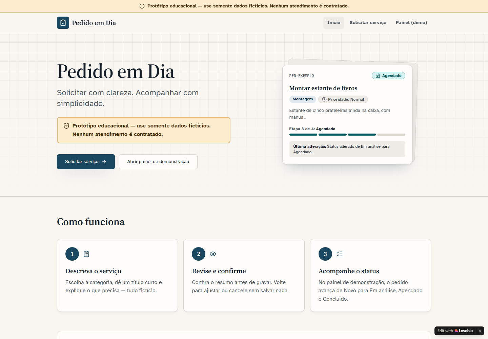
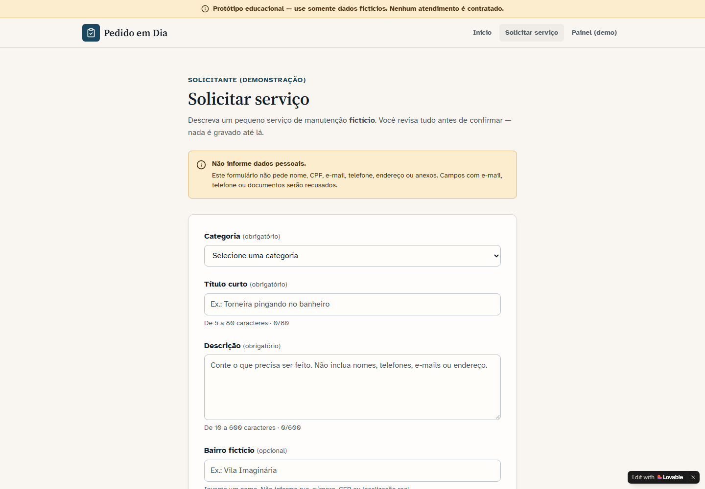

# Pedido em Dia

**Solicitar com clareza. Acompanhar com simplicidade.**

MVP educacional de uma aplicação web para registrar e acompanhar **solicitações fictícias** de pequenos serviços de manutenção residencial. O projeto foi criado como exercício de concepção de produto, construção assistida por IA e validação de um protótipo.

> **Atenção:** isto é uma demonstração didática. Não são oferecidos atendimentos reais, agendamentos, pagamentos nem contratos. Não insira dados pessoais reais.

## Problema e hipótese

Pequenos prestadores podem receber pedidos dispersos e incompletos, dificultando sua organização. Esta é uma **hipótese não validada com clientes**. O Pedido em Dia demonstra uma alternativa de formulário estruturado, confirmação de dados e acompanhamento por estados; não comprova demanda, economia de tempo ou viabilidade comercial.

## O que o MVP implementa

- Página inicial com explicação da proposta e aviso de uso fictício.
- Formulário com categoria, título, descrição, bairro fictício opcional e prioridade.
- Revisão e confirmação antes de salvar, com cancelamento sem persistência.
- Identificador local estável, inclusive após edição e mudança de estado.
- Painel de demonstração com os estados **Novo**, **Em análise**, **Agendado** e **Concluído**.
- Filtros, busca, contagens, edição, exclusão confirmada, exemplos fictícios e limpeza.
- Validação de campos e avisos para indisponibilidade do armazenamento.

**Não implementado:** autenticação, backend de pedidos, base remota, sincronização, WhatsApp, e-mail, cobrança, serviço efetivo ou IA conversacional.

## Arquitetura

A interface utiliza **React 19**, **TypeScript**, **TanStack Start/Router**, **Tailwind CSS 4**, componentes Radix e **Zod** para validação. **Vitest** e Testing Library compõem os testes. Os pedidos ficam no **localStorage** do próprio navegador, sem banco de dados de negócio. O framework usa SSR para hospedar a aplicação; isso não transforma o armazenamento em servidor multiusuário.

Arquivos principais:

- `src/routes/` — início, solicitação e painel.
- `src/components/pedidos/` — elementos do fluxo e da administração demonstrativa.
- `src/lib/pedidos/` — regras, validação, persistência, filtros e status.
- `src/test/` — testes automatizados.

## Executar e testar localmente

Requisitos: **Node.js 26** e **npm 11**, versões usadas na validação independente em 19/11/2026. O repositório possui `package-lock.json` e `bun.lock`; use **um único** gerenciador para cada instalação. O procedimento efetivamente testado foi:

```bash
npm ci --ignore-scripts
npm run test
npm run lint
npx tsc --noEmit
npm run build
npm run dev
```

O uso de `--ignore-scripts` vale para a instalação verificada, e pode exigir adaptação futura caso haja dependência legítima de scripts de instalação. O projeto possui preset de build Nitro/Cloudflare; publicação alternativa exige adequar o destino de hospedagem.

## Verificações realizadas

Em execução independente do código exportado e das correções de dependência:
- **17 testes automatizados aprovados** (2 arquivos de teste).
- **Lint e verificação TypeScript aprovados** após ajustes de formatação e compatibilidade com Zod 4.
- **Build de produção aprovado**.
- **npm audit com 0 vulnerabilidades reportadas**, na data e no conjunto de dependências auditados.

Auditoria com Bun: os alertas de severidade alta identificados inicialmente no `bun.lock` foram corrigidos; restou um alerta **moderado** em `minimatch`, dependência transitiva da ferramenta de desenvolvimento ESLint, sem função identificada no fluxo público de pedidos. Avaliações de segurança dependem das versões instaladas e devem ser revalidadas.

Esses resultados não provam ausência total de defeitos ou conformidade integral. O estudante já declarou a aprovação manual dos casos de cancelamento, campos obrigatórios, filtros, edição/exclusão e verificação básica de responsividade/teclado/contraste. Leitor de tela e falha real de armazenamento em navegador público não têm validação independente registrada.

## Mercado e Business Model Canvas — hipóteses

- **Segmentos:** prestadores autônomos de manutenção e pessoas que desejam organizar solicitações.
- **Proposta de valor:** clareza no pedido e visibilidade de andamento.
- **Canais:** link do formulário demonstrativo.
- **Relacionamento:** retorno humano manual em um eventual serviço real; não automatizado aqui.
- **Atividades e recursos:** receber e classificar pedidos, acompanhar estados; aplicativo e processo operacional.
- **Parceiros:** nenhum confirmado.
- **Receita possível:** hipótese de assinatura futura, não testada e não implementada.
- **Custos:** hospedagem, operação e manutenção ainda não quantificados.

**TAM/SAM/SOM:** não há dimensionamento específico validado. Não confundir estatísticas amplas de serviços com estimativa de clientes deste produto.

## Engenharia de prompts

O aplicativo foi especificado em PRD e mega prompt ratificados pelo estudante, com assistência de IA e implementação no Lovable. Consulte [o mega prompt autoral ratificado](docs/mega-prompt-autoral.md). A transcrição literal da mensagem enviada ao Lovable não está recuperável integralmente nesta versão do histórico acessível; o documento é identificado como **especificação autoral ratificada**, não como prova de entrada literal. O escopo efetivo e as correções estão refletidos no código e no histórico de commits.

A elaboração priorizou escopo mínimo, ausência de dados reais, confirmação antes da gravação, prevenção de duplicidade e persistência local sem custos externos.

## Segurança e privacidade

- Usar **somente dados fictícios**. As verificações textuais não identificam todos os nomes próprios nem endereços escritos por extenso.
- Qualquer pessoa com acesso ao mesmo perfil do navegador pode inspecionar, modificar ou apagar os registros.
- Limpar os dados do navegador remove os pedidos; não há sincronização nem backup em servidor.
- Nenhuma informação real de cliente deve ser tratada por este protótipo. O app não é solução certificada de LGPD ou segurança.
- Não existem contas individuais, pagamentos ou autenticação de usuários.
- Ferramentas do ambiente de desenvolvimento podem conter telemetria de erros; a divulgação pública não deve prometer ausência absoluta de telemetria.
- Bibliotecas e ativos de terceiros conservam seus direitos e licenças próprios.

## Aplicação publicada

**[Acessar o Pedido em Dia](https://pedido-em-dia-otavio-diniz.lovable.app)** — aplicação publicada no Lovable em 19/11/2026. As rotas `/`, `/solicitar` e `/painel` retornaram HTTP 200 em requisições públicas sem autenticação após o deploy. Esse teste de disponibilidade não substitui testes completos de interação.

### Capturas da aplicação publicada






As imagens foram capturadas por navegador headless diretamente das URLs públicas, em perfil isolado sem dados de cliente.

## Contexto e créditos

Atividade de aprendizagem no desafio *Da Ideia de Negócio ao MVP com Lovable*, do programa Santander — Construa seu Primeiro App com IA, na [Digital Innovation One](https://github.com/digitalinnovationone), com reconhecimento ao [Santander Open Academy](https://www.santanderopenacademy.com/pt_br/index.html). Não há endosso, parceria comercial nem vínculo profissional decorrente dessas menções.

## Licenciamento

Não foi atribuída licença de reutilização ao código próprio. As dependências mantêm seus direitos e licenças próprios. A ausência de um arquivo LICENSE não autoriza reutilização ampla por terceiros.
