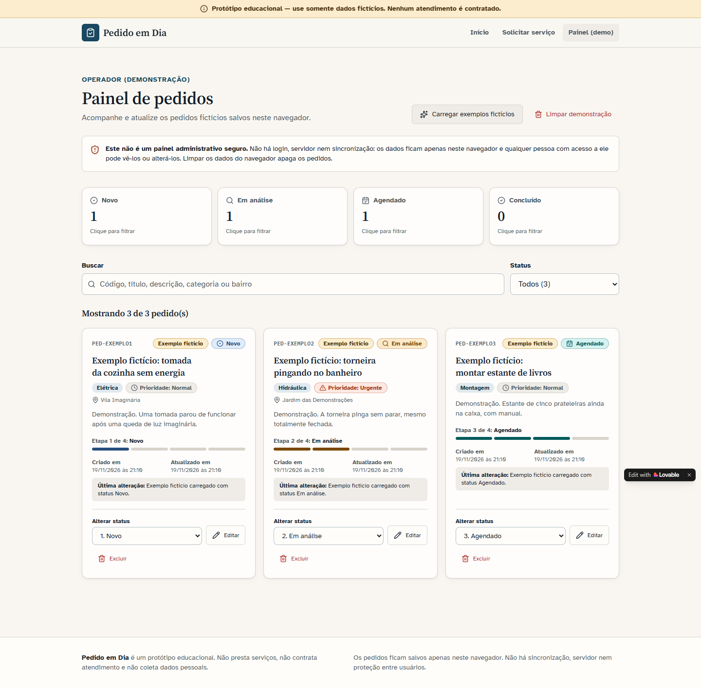

# Pedido em Dia

**Solicitar com clareza. Acompanhar com simplicidade.**

**Protótipo educacional funcional | Santander — Construa seu Primeiro App com IA / DIO | React + TypeScript**

O **Pedido em Dia** demonstra como organizar solicitações **fictícias** de pequenos serviços de manutenção residencial, do formulário à revisão humana e ao acompanhamento por status. O público hipotético são prestadores autônomos e pessoas que precisam descrever e acompanhar pedidos sem informações dispersas.

> **Demonstração, não serviço real:** não oferece contratos, atendimento, pagamentos ou agendamentos efetivos. Não informe dados pessoais, contatos ou endereços verdadeiros.

**[Abrir a aplicação pública](https://pedido-em-dia-otavio-diniz.lovable.app)** · [Ver o guia de reprodução](docs/guia-reproducao.md) · [Decisões e validação](docs/decisoes-e-validacao.md)

## Problema e proposta de valor

**Hipótese a validar:** pedidos de manutenção recebidos por conversas soltas podem chegar incompletos e ser difíceis de acompanhar. O protótipo testa, apenas em demonstração, se estruturar a solicitação e mostrar o estado do pedido ajuda a tornar a comunicação mais clara. Não há evidência de demanda, clientes, redução de custos ou ganhos de produtividade.

## Solução e fluxo principal

1. O solicitante escolhe uma categoria, descreve um serviço **inventado** e informa uma prioridade.
2. Antes de gravar, revisa os dados e pode voltar, cancelar ou confirmar.
3. Após confirmar, recebe um identificador local estável e o status **Novo**.
4. No **Painel (demo)**, acompanha estados, filtra, pesquisa, edita e exclui os registros fictícios.

Não existem contas de usuário, acesso compartilhado, envio de mensagens, WhatsApp, base remota nem painel administrativo protegido. A expressão “Agendado” é apenas um **estado simulado**; não cria visitas reais.

## Estado atual e demonstração

**MVP educacional publicado:** a página inicial, a solicitação e o painel estão acessíveis publicamente. O código está neste repositório, e **17 testes automatizados** passaram em execução independente em 19/11/2026. A validação com clientes e a homologação acadêmica institucional **não são inferidas** desse estado técnico.

<details>
<summary>Ver capturas autênticas do aplicativo publicado (somente dados fictícios)</summary>

**Página inicial**


**Solicitação fictícia**


**Painel após carregar três exemplos fictícios**



</details>

## Quickstart — do clone ao primeiro uso

Pré-requisitos do ambiente **efetivamente testado**: Windows, Node.js **26.13.1**, npm **11.20.0**, Git e acesso ao registro npm. Outras plataformas e versões não foram homologadas.

```bash
git clone https://github.com/otavio-diniz/pedido-em-dia.git
cd pedido-em-dia
npm ci --ignore-scripts
npm run dev
```

Abra a URL local informada pelo Vite (frequentemente `http://localhost:5173`). Se preferir experimentar **sem instalação**, use a [demonstração publicada](https://pedido-em-dia-otavio-diniz.lovable.app).

No painel, use **Carregar exemplos fictícios** para explorar três casos sintéticos; ou crie uma solicitação no formulário e confirme. A persistência é exclusiva de cada navegador/perfil e não sincroniza dispositivos.

**Reprodução, testes, saídas esperadas, limitações de ambiente e troubleshooting:** [guia de reprodução](docs/guia-reproducao.md). Este é o local canônico para os comandos de validação e detalhes operacionais.

## Arquitetura, tecnologias e código

| Camada | Implementação real |
|---|---|
| Interface | React 19, TypeScript, Tailwind CSS 4 e componentes Radix |
| Rotas e renderização | TanStack Router/Start e infraestrutura Vite/Nitro |
| Regras e validação | TypeScript, Zod 4 e checagens de dados sensíveis por padrões simples |
| Persistência demonstrativa | `localStorage` do navegador, **sem banco de dados cloud de pedidos** |
| Testes | Vitest e Testing Library |
| Criação assistida | Lovable e engenharia de prompts |

Pastas principais: `src/routes/` (páginas), `src/lib/pedidos/` (validação, IDs, armazenamento e filtros), `src/components/pedidos/` (interface) e `src/test/` (testes). `package-lock.json` e `bun.lock` registram resoluções de dois gerenciadores; use **apenas um** deles por instalação.

## Testes e evidências

A partir de instalação limpa com npm, em **19/11/2026**, foram reproduzidos **17/17 testes** (2 arquivos), lint, verificação TypeScript e build com código de saída zero. O `npm audit` daquele conjunto reportou **0 vulnerabilidades**. A auditoria do `bun.lock` corrigido ainda aponta **1 vulnerabilidade moderada** em uma dependência transitiva do ESLint; isso não é uma aprovação global de segurança.

A versão hospedada no Lovable **não está comprovadamente sincronizada** com todas as correções transitivas de lockfile feitas no GitHub. O acesso HTTP às rotas públicas e as capturas de tela comprovam disponibilidade e aparência observada, mas não certificam o conjunto completo de interações, segurança ou acessibilidade.

Detalhes rastreáveis, diferenças entre versões, testes e limites: [decisões e validação](docs/decisoes-e-validacao.md).

## Segurança, privacidade e limitações

- Os pedidos permanecem apenas no navegador que os criou; apagar o armazenamento remove os registros.
- A detecção por padrões de e-mail/números é **parcial** e não impede todo tipo de informação pessoal. Use só dados fictícios.
- Qualquer pessoa com acesso ao mesmo perfil de navegador pode ler, alterar ou apagar os pedidos.
- Não há autenticação, processamento de pagamentos, proteção multiusuário, atendimento real nem certificação de conformidade com a LGPD.
- O aplicativo pode carregar fontes web externas; a publicação não deve ser interpretada como ausência absoluta de recursos ou telemetria de terceiros.
- A análise de segurança do ambiente Lovable deve ser repetida após sincronização das dependências e antes da homologação final.

## Mercado, tese e Business Model Canvas — hipóteses

**Tese de produto:** estruturar pedidos demonstrativos e dar visibilidade ao estado pode facilitar a organização de pequenos serviços. Isso **ainda não foi validado comercialmente**.

| Bloco do Canvas | Hipótese de trabalho, não resultado |
|---|---|
| Segmentos de clientes | Prestadores autônomos de manutenção e pessoas que fazem solicitações |
| Proposta de valor | Pedidos mais claros e rastreamento simples |
| Canais | Link de formulário ou compartilhamento direto |
| Relacionamento | Contato humano manual em eventual operação futura |
| Fontes de receita | Possível assinatura futura — **não implementada ou testada** |
| Recursos principais | Interface, processo de triagem e disponibilidade do operador |
| Atividades principais | Registrar, organizar e acompanhar solicitações |
| Parcerias principais | Nenhuma parceria comercial confirmada |
| Estrutura de custos | Hospedagem, atendimento e manutenção — valores **não estimados** |

**TAM/SAM/SOM:** o levantamento atual permite formular hipóteses de público, mas **não sustenta valores monetários ou números de clientes** do Pedido em Dia. Estimativas exigiriam delimitação geográfica, fontes oficiais, premissas documentadas e validação humana; não foram apresentadas como números comprovados.

## Engenharia de prompts e aprendizados

O escopo foi definido em PRD e [mega prompt autoral ratificado](docs/mega-prompt-autoral.md), com apoio de IA e prototipação no Lovable. A especificação publicada **não se apresenta como cópia literal autenticada** de todo o conteúdo enviado ao editor.

As decisões verificáveis incluem limitar dados a exemplos, exigir confirmação antes da gravação, preservar identificadores e separar um painel demonstrativo de uma área administrativa real. Consulte [as mudanças e verificações observadas](docs/decisoes-e-validacao.md). **Não são inventadas mensagens de correção** cuja literalidade não tenha sido recuperada.

## Possibilidades futuras — não implementadas

Pesquisa com usuários e prestadores; validação quantitativa de mercado; uma arquitetura cloud com privacidade e autenticação adequadas; testes de acessibilidade com tecnologia assistiva; sincronização real entre dispositivos. Nenhuma dessas possibilidades é apresentada como funcionalidade existente ou entrega concluída.

## Contexto acadêmico, referências e reconhecimento

Este projeto integra, como exercício autoral, o desafio **“Da Ideia de Negócio ao MVP com Lovable”** no programa **Santander — Construa seu Primeiro App com IA**, ofertado no ecossistema de aprendizagem da **[DIO — Digital Innovation One](https://github.com/digitalinnovationone)**, com reconhecimento ao **[Santander Open Academy](https://www.santanderopenacademy.com/pt_br/index.html)**. Agradeço pelo contexto formativo e pelas referências didáticas. **A menção não implica endosso, aprovação, certificação, parceria ou vínculo profissional** dessas entidades com o projeto.

Outros trabalhos públicos **independentes** do mesmo autor, citados apenas como contexto de aprendizagem:
- [Mapa do Mês — Finanças Pessoais com IA](https://github.com/otavio-diniz/mapa-do-mes-financas-pessoais-ia): exercício de Vibe Coding do programa Santander/DIO, sem código executável publicado nesse repositório.
- [Assistente de Investimentos com RPA e n8n](https://github.com/otavio-diniz/dio-lab-assistente-investimentos-rpa-n8n): outro programa Santander/DIO, relacionado à automação, não componente do Pedido em Dia.

## Autoria, licença e direitos de terceiros

**© 2026 Otávio Diniz. Todos os direitos reservados sobre os materiais autorais específicos deste projeto, observados os direitos de terceiros.** O repositório é público para demonstração, inspeção e avaliação acadêmica, **não é software de código aberto licenciado para reutilização irrestrita**.

Os termos de avaliação limitada, proveniência, atribuições e direitos de componentes de terceiros estão em [LICENSE](LICENSE) e [NOTICE.md](NOTICE.md). Para relatar erros ou sugerir melhorias, consulte [CONTRIBUTING.md](CONTRIBUTING.md).
